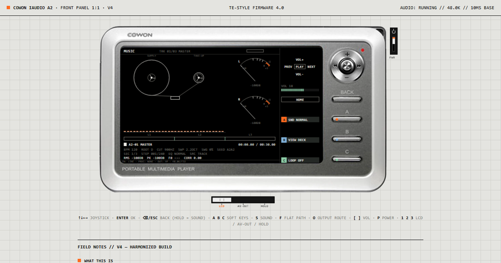

# COWON iAUDIO A2 — TE BENCH

**A re-imagined COWON iAUDIO A2: part hardware overhaul, part app, part portable music factory.**

[**Live project hub**](https://bortknox.github.io/Cowon-a2-transformation-demo/) ·
[**All canvases**](https://bortknox.github.io/Cowon-a2-transformation-demo/versions/) ·
[**Roadmap**](docs/ROADMAP.md) · [**Releases**](https://github.com/BortKnox/Cowon-a2-transformation-demo/releases)



## Status

**Canvas stage.** The project is being designed in the browser first: each version is a single-file,
self-contained HTML canvas you can operate. No installers exist yet — the first Android APK will be a
tagged [Release](https://github.com/BortKnox/Cowon-a2-transformation-demo/releases), not a file in this repo.

## Live canvases

| Version | State | What it is | Open |
|---|---|---|---|
| **v4** | latest | Current canvas: the 24-mode structure carried forward, with ongoing work on input handling and the music screen. The in-page changelog still describes what v3 added. | [open v4](https://bortknox.github.io/Cowon-a2-transformation-demo/v4/) |
| **v3** | stable | 24 modes, OP-1 style tape reels, signal-flow sound chain, rebuilt icons, RANK feasibility percentages for the A2 and a PC build. | [open v3](https://bortknox.github.io/Cowon-a2-transformation-demo/v3/) |
| **v2** | archive | 17 modes. Looper, recorder, sound chain, routing and a status line. | [open v2](https://bortknox.github.io/Cowon-a2-transformation-demo/v2/) |
| **v1** | archive | The original: real photo chassis, 8 modes. Kept as the reference and the rollback. | [open v1](https://bortknox.github.io/Cowon-a2-transformation-demo/v1/) |

Every canvas runs from the site with nothing to install. Click once (or press any key) to arm audio, then
press Enter on MUSIC.

## What this is

- **Hardware.** The starting point was a real iAUDIO A2 taken apart and rebuilt with new firmware. The
  device's own panel — screen window, joystick, soft keys — is reproduced 1:1 in the canvas, so the layout
  is validated before any port exists.
- **Canvas.** One HTML file per version: no build step, no dependencies, no network calls. It is where the
  app is designed and stress-tested in a browser.
- **Instrument.** Audio is synthesised live with the Web Audio API and the meters read from real analyser
  nodes. The destination is a production instrument with guitar and vocal processing — not a media-player skin.

## Ports and downloads

| Target | Status | Notes |
|---|---|---|
| **Web canvas** | available | Every version runs from this repo's Pages site. |
| **Android (APK)** | planned | First real port. Signed builds attach to a Release. |
| **iOS** | research | Needs an Apple Developer account and TestFlight; sideloading an IPA is not a normal route. |
| **Desktop** | planned | Windows first, then macOS and Linux. Where low-latency guitar/vocal input gets serious. |
| **A2 hardware** | research | The original dream: installable firmware on a physical iAUDIO A2. Still the north star, still unproven. |

Details, signing rules and the release checklist: [docs/PACKAGING.md](docs/PACKAGING.md).

## Companion tools

**[A2 Video Forge](tools/a2-video-forge/README.md)** — a Windows folder-watching transcoder for the real
device. Drop a video into the inbox and it produces a 480×272 XviD + MP3 AVI the A2 can play. Python + FFmpeg,
no telemetry. The canvases imagine the A2's future; this keeps the hardware useful today.

## Repo layout

```
index.html        # project hub — the GitHub Pages root
v1/ v2/ v3/ v4/   # frozen canvases, one per version, never edited
versions/         # gallery linking every canvas
assets/           # chassis cut-out and preview images
docs/             # ROADMAP.md, PACKAGING.md
tools/            # chassis cut-out script, a2-video-forge/ (Windows transcoder)
CONTRIBUTING.md   # the rules for adding a version
```

## Run locally

Any canvas is a single file — open it directly:

```bash
git clone https://github.com/BortKnox/Cowon-a2-transformation-demo.git
cd Cowon-a2-transformation-demo
start v4/index.html        # Windows
# open v4/index.html       # macOS
```

To preview the whole site with working relative links, serve the folder instead (`python -m http.server`,
then open <http://localhost:8000/>).

## Docs

- [docs/ROADMAP.md](docs/ROADMAP.md) — the phases, the open questions, and what is deliberately not built yet.
- [docs/PACKAGING.md](docs/PACKAGING.md) — versioning, artifact names, signing and the release checklist.
- [CONTRIBUTING.md](CONTRIBUTING.md) — how a new canvas version gets added.

## License

MIT — see [LICENSE](LICENSE). The canvases, the hub and the tooling in `tools/` are covered.

This is an unofficial fan project. **COWON** and **iAUDIO** are trademarks of their respective owner; the
name is used descriptively, and nothing here is endorsed by or affiliated with COWON Systems.
